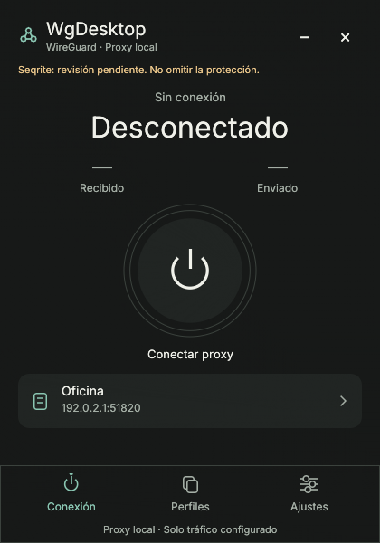

# WgDesktop — cliente WireGuard en Rust

Proyecto Windows-first con dos modos previstos: proxy local y VPN completa.

**Estado actual: interfaz de escritorio y proxy experimental; VPN completa pendiente.**

> **Aviso de seguridad en investigación:** Seqrite Endpoint Protection ha señalado
> el ejecutable de escritorio como «Potential Keylogger». No se ha confirmado que
> sea un falso positivo. No ejecutar de nuevo ni desactivar la protección o añadir
> excepciones hasta completar la revisión. Ver [diagnóstico](docs/endpoint-alert.md).

## Abrir la aplicación

Haz doble clic en **`Abrir-WgDesktop.cmd`** en la raíz del proyecto, o directamente
en **`target\release\wg-desktop.exe`**. Sin argumentos se abre una ventana; ya no
se cierra inmediatamente mostrando ayuda de consola.

En la ventana puedes abrir o arrastrar un `.conf`, guardarlo cifrado, elegir el
puerto y conectar/desconectar el proxy. La VPN completa aparece deshabilitada:
todavía no está implementada. No hace falta abrir PowerShell para usar la GUI.

Los comandos de consola siguen disponibles cuando se especifican argumentos.

### Interfaz

- Ventana fija de **420 × 600** puntos lógicos, exclusivamente vertical y sin maximizar.
- Una sola cabecera oscura, sin barra blanca de Windows; minimizar y cerrar
  integrados, y arrastre desde el encabezado.
- Tres pestañas: **Conexión**, **Perfiles** y **Ajustes**. Sin barra lateral.
- Panel compacto con una única acción principal según el estado.
- Métricas de tráfico en unidades legibles; sin cifras inventadas al desconectar.
- Puerto, DNS, redes y ayuda en Ajustes; búsqueda e importación en Perfiles.
- Guardado cifrado en un diálogo dedicado y validación antes de conectar.
- Tema oscuro fijado explícitamente, independiente del tema claro de Windows.
- Diseño oscuro minimalista, tipografía Inter, control circular y navegación inferior.
- Superficies carbón, texto marfil y acento verde suave; duración de sesión real.
- Búsqueda con limpieza, confirmación al copiar y validación al guardar perfiles.
- Desplazamiento vertical para contenido largo, sin distribución horizontal.

El rediseño visual no resuelve la alerta de Seqrite. Su revisión sigue pendiente.

Se preparó una mitigación en la dependencia gráfica: elimina la consulta global
del teclado al recibir foco y el registro de entrada raw en Windows. Falta
validar el nuevo ejecutable con Seqrite. Los cambios y sus límites están en el
[diagnóstico](docs/endpoint-alert.md); `scripts/check-input-imports.ps1` comprueba
los imports del ejecutable sin abrirlo.

Vista del nuevo diseño, renderizada en memoria con datos de prueba y sin abrir
la aplicación nativa:



Más estados y detalles de validación en [diseño de interfaz](docs/ui-design.md).

| Función | Estado |
|---|---|
| Parser y validación de `.conf` | Implementado |
| Resúmenes sin claves privadas | Implementado |
| Perfiles cifrados con DPAPI del usuario | Implementado en Windows |
| WireGuard en espacio de usuario | Prototipo BoringTun |
| SOCKS5 CONNECT y DNS dentro del túnel | Prototipo smoltcp |
| VPN completa, servicio y kill switch | Pendiente |
| GUI para perfiles, proxy y estadísticas | Implementado |
| Selector hacia VPN completa | Pendiente del backend VPN |
| Instalador | Pendiente |

El modo proxy **no crea un adaptador VPN ni cambia rutas, DNS o proxy de Windows**.
Solo transporta las conexiones TCP que una aplicación entregue al proxy. No es
una garantía de que todo el tráfico de un navegador esté protegido.

## Requisitos

- Windows x64 y herramientas de compilación MSVC con Windows SDK.
- Rust estable reciente y Cargo.
- Un peer WireGuard configurado y una configuración propia compatible.
- Para salir a Internet: forwarding, rutas y NAT correctamente configurados en
  el servidor. Un handshake no demuestra por sí solo acceso a Internet.

No se necesita instalar el cliente oficial para este prototipo.

La interfaz usa OpenGL; si no puede crear la ventana, muestra un diálogo con el
error en lugar de cerrarse sin explicación.

## Compilación y pruebas

```powershell
cargo test --workspace
cargo fmt --all -- --check
cargo clippy --workspace --all-targets -- -D warnings
cargo build --release -p wg-desktop
```

Si se utiliza la toolchain aislada instalada durante el desarrollo, el script
`scripts/dev.ps1` la detecta sin modificar el PATH global:

```powershell
.\scripts\dev.ps1 -CargoArguments @('test', '--workspace')
.\scripts\dev.ps1 -CargoArguments @('run', '-p', 'wg-desktop', '--', 'doctor')
```

Usar un array explícito conserva los separadores `--` al invocar el script desde PowerShell.

## Uso

Validar una configuración sin conectarse ni revelar claves:

```powershell
cargo run -p wg-desktop -- validate --config C:\ruta\personal.conf
```

Importar un perfil cifrado para el usuario actual:

```powershell
cargo run -p wg-desktop -- import --config C:\ruta\personal.conf --name oficina
cargo run -p wg-desktop -- list
cargo run -p wg-desktop -- validate --profile oficina
```

Los perfiles se guardan en `%LOCALAPPDATA%\WgDesktop\profiles`. DPAPI vincula
su descifrado al usuario de Windows; los archivos no son portables entre usuarios.
El `.conf` original **no se elimina ni cifra automáticamente**. Protégelo por separado.
Los nombres existentes nunca se sobrescriben.

Iniciar el proxy:

```powershell
cargo run -p wg-desktop -- proxy --profile oficina --listen 127.0.0.1:1080
# Alternativa sin importar:
cargo run -p wg-desktop -- proxy --config C:\ruta\personal.conf
```

La CLI espera el handshake antes de aceptar conexiones SOCKS. Usa `Ctrl+C` para
cerrar el proxy y el túnel.

Ejemplo con resolución remota:

```powershell
curl.exe --socks5-hostname 127.0.0.1:1080 https://example.com
```

`--socks5-hostname` entrega el nombre al proxy. `--socks5` puede resolverlo antes
en Windows, fuera del túnel. En Firefox, habilitar la resolución DNS mediante
SOCKS v5. En Chrome, usar un perfil dedicado y su configuración de proxy, pero
validar por separado WebRTC, QUIC y cualquier conexión que evite el proxy.

No actives el mismo perfil simultáneamente en el cliente oficial de WireGuard y
en WgDesktop. Para usar el proxy de WgDesktop, desactiva primero ese túnel en el
cliente oficial. La app comprueba si la dirección del perfil ya está asignada al
sistema y muestra un error antes de iniciar otra sesión; no desactiva túneles ni
modifica rutas automáticamente.

### Si conecta pero el navegador no carga

Con WgDesktop conectado, haz doble clic en **`Diagnosticar-Proxy.cmd`**, junto a
`Abrir-WgDesktop.cmd`. Abre un informe en Bloc de notas y guarda otra copia en
`%LOCALAPPDATA%\WgDesktop\diagnostics`.

La prueba distingue acceso al puerto local, protocolo SOCKS5, conexión a una IP
sin DNS, conexión por nombre (DNS y TCP), validación TLS y respuesta HTTPS.
Las solicitudes de prueba usan el proxy hacia `1.1.1.1:443` y `example.com:443`;
no hay conexión TCP directa de respaldo hacia esos destinos. Los certificados
se validan con las reglas habituales de Windows.
No lee perfiles, claves, historial ni cookies; no cambia DNS, rutas ni opciones
del navegador y no abre otro cliente WireGuard. Puede tardar unos 40 segundos.

Para elegir otro puerto o generar un informe sin abrir el editor:

```powershell
.\scripts\diagnose-proxy.ps1 -Port 1080 -NoOpen
```

## Límites y seguridad del prototipo

- Un peer por perfil, una dirección por familia y hasta dos DNS expresados como IP.
- UTF-8, configuración de hasta 64 KiB y MTU entre 1280 y 9000; valor predeterminado 1280.
- SOCKS5 TCP sin autenticación, solo loopback; otros procesos locales pueden usarlo.
- No soporta SOCKS UDP, BIND, HTTP CONNECT ni scripts `PreUp`/`PostUp`/similares.
- Los campos desconocidos y duplicados se rechazan, no se ignoran.
- Los destinos deben estar en `AllowedIPs` y disponer de una dirección local de
  la misma familia. Las respuestas descifradas también pasan por la política del peer.
- DNS de destinos únicamente por el túnel. Si no hay DNS configurado, solo se
  pueden solicitar IPs directamente. No hay fallback al DNS del sistema.
- Si el endpoint de WireGuard es un hostname, su resolución inicial sí utiliza
  DNS del sistema. El primer endpoint devuelto se utiliza durante la sesión;
  la rotación/re-resolución automática queda pendiente.
- Se prefiere A y se intenta AAAA si existe dirección IPv6 y no hay resultado
  IPv4 permitido. No hay Happy Eyeballs ni reintento de varias IPs TCP todavía.
- El DNS de smoltcp usa UDP; respuestas que requieran fallback a TCP no están soportadas.
- La CLI no incorpora fallback TCP directo hacia los destinos.
- No existe kill switch global: aplicaciones que no usen el proxy siguen
  conectándose normalmente. Un handshake antiguo no prueba conectividad actual.
- Máximo de 128 conexiones TCP en el motor y 128 clientes SOCKS concurrentes.
- Las conexiones TCP de la pila tienen un timeout de inactividad de 60 segundos.
- El transporte se desconecta ante errores UDP fatales. No hay recuperación
  automática de cambios de red o suspensión todavía.
- Datos y claves nunca se imprimen intencionadamente en los logs. Evitar
  compartir perfiles reales o capturas con información sensible.

`tests/fixtures/example.conf` contiene claves públicas de prueba y un endpoint de
documentación. **No es una configuración utilizable ni segura para una VPN real.**

## Arquitectura y siguientes fases

Ver [arquitectura](docs/architecture.md), [pruebas de laboratorio](docs/lab-testing.md)
y [estado de implementación](docs/implementation-status.md).

Antes de usarlo como herramienta de privacidad hay que completar las pruebas
contra un peer real y revisar capturas de tráfico. Las pruebas automatizadas
locales no sustituyen esa validación.
